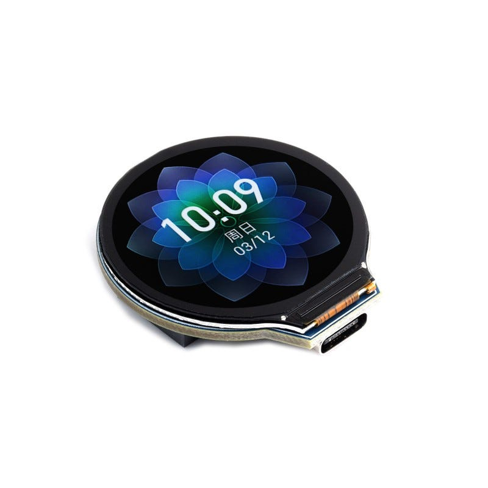
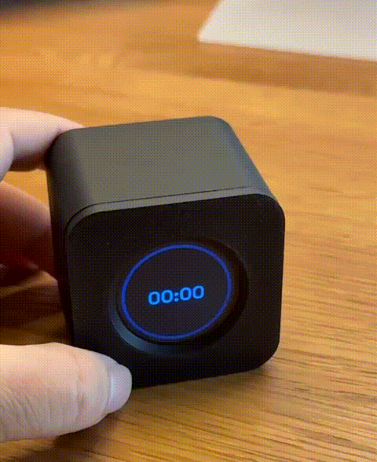
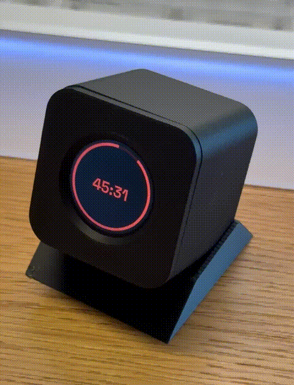

This article is **migrated** from [Medium](https://medium.com/@k2345777/%E9%87%8D%E5%8A%9B%E8%A8%88%E6%99%82%E5%99%A8-esp32%E7%95%AA%E8%8C%84%E9%90%98%E5%B0%88%E6%A1%88-9484da297b8b) and **translated** by Claude.

---

This time, an actual human wrote this post — which might make it a bit of a rarity these days.
Actually this was written in Manderin and translate to English by Sonnet 5.

### A Distraction-Prone Brain

I get distracted easily. I'll open up my work, but end up browsing other tabs, replying to messages, or chasing some random idea that just popped into my head — anything except actually starting. Usually it's not until the deadline is bearing down that productivity finally shows up, dragged in by the stress. Things get done, but at the cost of a lot of pressure.

I found some work-focused playlists and paired them with the Pomodoro rhythm, and it turns out I'm at least a little bit conditionable. Once the timer starts, some part of me automatically switches into "focus mode" — thirty minutes to an hour of work, followed by a break — and looking back afterward, I'd actually gotten a decent amount done. I really like that effect.

The problem is I couldn't pick the music myself, and sometimes I didn't want music at all — no way around that. You might say, just use a dedicated app? But by the time you unlock your phone and find the app, you've probably already scrolled through half your social feeds. By the time you remember what you were supposed to be doing, you've already burned a chunk of time.

So I went looking online for a physical product that could solve this. I found some cube-shaped timers with a UI I really liked, but not quite enough to make me hit "buy." If you're curious, search for "cube Pomodoro timer" or "gravity Pomodoro timer" — you'll see what I mean.

And there it was again — that little voice. Build one myself? Could I actually do that? ...Yeah, I think I could.

### Hardware Selection

Basically what I needed was a screen, an IMU sensor, and an MCU capable enough to draw a UI. I found a pretty good match on Waveshare: a 1.28-inch round display paired with an ESP32-S3 and a 6-axis IMU, plus a battery connector and charging IC already built in. Essentially no extra wiring needed to start developing — so that was the one.

### Vibe Coding with Claude

This time I brought out Claude, the vibe-coding tool everyone keeps recommending, to give it a shot. Maybe I don't actually love writing code as much as I thought I did. Sure, grinding out a feature I'm happy with can feel rewarding, but the pain along the way is usually what makes me abandon a project halfway through. And AI writes code so fast now that debugging things slowly by hand starts to feel like a poor return on investment. That's been my takeaway lately, and honestly, it's a bit of a bittersweet realization.

### Design Philosophy: Flip and Tap

Let me walk through my design thinking for this project. First, the human-device interaction had to be simple — ideally just one or two gestures. That's how I landed on flip and tap. Neither requires a physical button or a touchscreen, and neither needs precise handling — anyone should be able to just pick it up and use it. I'm a bit stubborn about this kind of design: if a product needs a long manual before you can use it, its potential audience shrinks immediately. Though, thinking about it, this project is really only ever going to be used by me, maybe gifted to a friend at most. So let's just say I genuinely like this kind of simple interaction model.

The other thing I really cared about was the rotation animation — it had to be smooth enough that flipping the device gave an oddly satisfying, stress-relieving feeling. Maybe that's just me. It sounds like an obvious requirement, but getting there took several iterations: filtering on the raw IMU data, the sensor fusion parameters, the fusion update interval — all of these had a huge effect on how smooth the flip felt. I eventually landed on a version that felt genuinely satisfying.

_Flip_

_Tap_

### Working with Claude: Knowing When AI Is Wrong

Now, about working with Claude. This project was actually entirely within my own wheelhouse, except for the LVGL middle layer driving the screen. So it was easy for me to stay in control of the direction, and I could tell right away when the AI was talking nonsense or heading the wrong way. I think this is the biggest problem I've run into lately when working with AI: if you let it push forward and execute on something you have zero grasp of yourself, you usually end up stuck going back and forth in the same place for a long time, with no good way to steer it back on track. But because it's so easy to just tell AI what to do, we're increasingly less inclined to actually digest or question whether the current step even makes sense.

This is starting to sound preachy, so let me get back on track. I ran into a similar problem on this project too — when the display driver hit some bugs, I genuinely had a hard time figuring out where things were actually stuck, and I didn't have the time to dig in and debug it myself. Or, more honestly, I just didn't feel like spending extra time on a side project. I selfishly wanted to focus on the parts I actually cared about — designing the whole interaction flow, designing the enclosure, and so on — and just lean on AI for everything else.

### Bringing in a Second Opinion (at a Price)

The model I picked was Sonnet 5. When I hit a problem that stayed stuck for a long time with no solution in sight, I had it write up a document describing the issue, the solutions I'd already tried, and the results. Then, at considerable expense, I brought in the most famous model of them all — Fable 5.1! That's when I discovered that even though I'm subscribed to Claude, Fable 5.1 is billed completely separately — you need to top up credits specifically to use it. But since the project was almost done and I really didn't want to drag it out for another few weeks and lose my patience, I topped up USD $20 to give this heavyweight a try.

I have to admit, it actually solved the problem. It read through the document the previous model had put together, then wrote its own document explaining the issue and offering two or three possible solutions. I'd then hand that write-up back to Sonnet 5 — basically, "hey, look how good your colleague is, maybe learn a thing or two" — and following the suggested solution would usually clear whatever it was stuck on. Meanwhile, I served as the "critical" bridge in the middle, faithfully relaying the conversation between the two of them.

But Fable 5.1 really is expensive — my $20 was gone after just three questions. Thankfully the project was finished by then. I seriously suspect Sonnet 5 was deliberately getting stuck right near the finish line, hoping to bait me into spending money on Fable 5.1. I have no proof, of course.

### Open Source

Anyway, if you'd like to try building one yourself, I've open-sourced everything here: [github.com/bolintw/Kairos](https://github.com/bolintw/Kairos)
