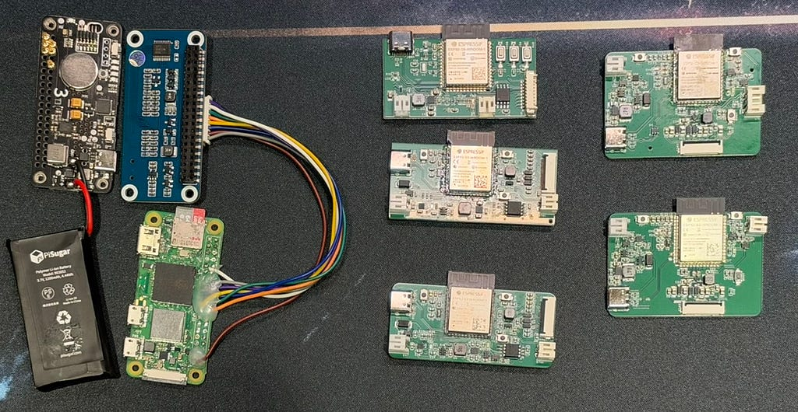
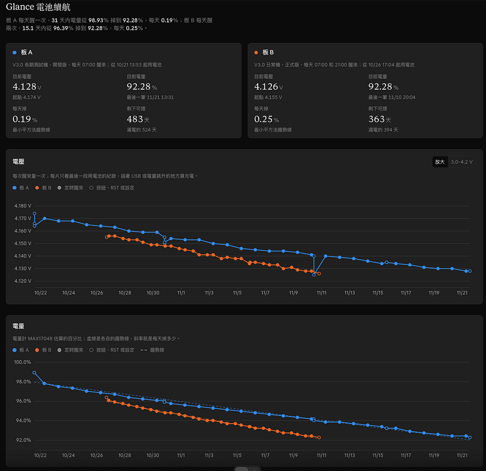
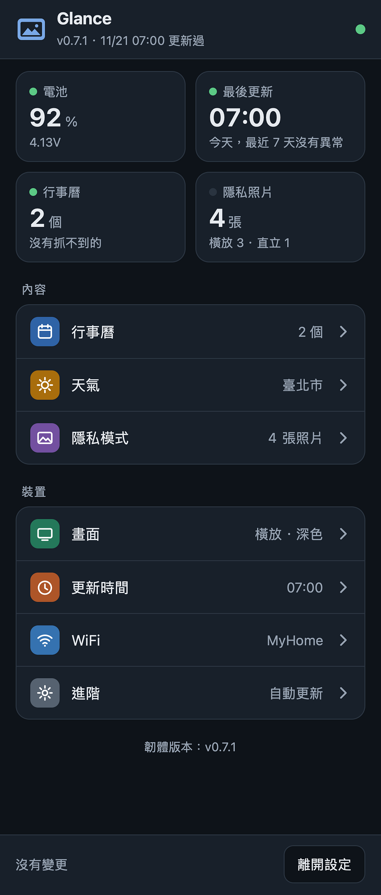

This article is **migrated** from [Medium](https://medium.com/@k2345777/%E9%9B%BB%E5%AD%90%E7%B4%99%E6%9C%88%E6%9B%86v2-%E7%B5%82%E6%96%BC%E9%81%94%E5%88%B0%E9%87%8C%E7%A8%8B%E7%A2%91-92e1ed7fffb4) and **translated** by Gemini 4 Neon High.

---

This post was actually written by me, by hand.

Even though probably no one was waiting, I still want to say: sorry for the wait! It's been over a year since the V2 project kicked off, and V2 has finally reached the milestone I had in mind.

### Looking Back at the Original Goals

Let's revisit the goals I set when starting this project:

- Replace the Raspberry Pi with an ESP32 to lower cost and power consumption
- Power it with a single 18650 Li-ion battery, targeting 1–3 months of battery life
- Support AP mode for configuring Wi-Fi, uploading ICS links, background images, and more
- Use an SD card and JSON config file for UI customization and layout configuration
- Implement voltage monitoring and low-battery protection

Those were the original goals. A year later, a few details changed along the way, but for the most part, I've checked them off. The new mainboard runs on an ESP32-S3. Even though it doesn't use an 18650 cell, it achieves astonishing battery life on a smaller 1000mAh Li-ion battery — arguably the biggest highlight of this upgrade. Next is a complete overhaul of the user interface, which is another area I poured a lot of effort into, aiming to make sure most people can pick up the device and use it smoothly without needing a manual.

As for UI customization and layout configuration, that's the one goal I didn't hit. The scope turned out to be way bigger than I imagined, and right now I just don't have the bandwidth to take on something that huge. That said, since I added OTA updates this time around, maybe I'll gradually add support for it down the road (making an even bigger promise?!).

### Hardware Evolution

Let's start with the hardware. On the far left is the V1 setup: a Raspberry Pi, display driver board, power management module, and battery. On the right are the custom PCBs I designed for V2 — v1.0, v2.0, v2.1, v3.0, and v3.1. Just looking at those revision numbers, you can probably tell I rushed to send boards out for fabrication without thoroughly validating each version first, so plenty of hardware issues only popped up midway through, forcing another redesign and another order. Every single one of those boards cost quite a bit of money...

Still, to sum it up: the core is now an ESP32-S3, paired with an onboard display driver circuit, RTC crystal, power path management, charging circuit, and a low-power design. The footprint shrank dramatically — just plug in a battery, and this single board covers everything the pile of hardware on the left used to do.

Of course, shrinking the size and cost down to what you see on the right came with plenty of trade-offs. First and foremost, memory and storage are dramatically more constrained. That gave me quite a few headaches when rendering Traditional Chinese fonts, forcing me to make compromises based on design priorities. Naturally, it's hard to match the near-infinite flexibility and freedom that the Raspberry Pi setup on the left offered.

### Over a Year of Battery Life

That said, we also gained some major upgrades — otherwise I wouldn't have kicked off V2 just to cut cost and size. The biggest leap is battery life. On V1, I attached a PiSugar power management module with its own RTC to schedule when to power on the Raspberry Pi and put itself to sleep once the Pi shut down. That brought V1 to about three months of battery life — meaning unplugged with one refresh per day, you only had to recharge it once every three months.

V2's battery life is still undergoing long-term testing, but based on both calculations and a full month of real-world operation, a 1000mAh battery (compared to the 1200mAh battery on V1) refreshing once a day can easily last **over a year**. *That* is the biggest win of this circuit design.

### Upgraded UI, Privacy Mode, and OTA

To keep this post from dragging on forever, I'm going to wrap things up quickly (maybe?).

In short, the user interface has leveled up by more than just a notch. Everything can now be configured easily from your phone through a clean, good-looking UI. I also solved a major pain point from V1: having guests come over, see your entire schedule at a glance, and go home reciting all your plans to their friends. So I added a **Privacy Mode**, where you can upload your favorite photos and cycle through them like a photo frame.

Anyway, as mentioned above, this version also supports OTA updates, so new features will keep rolling out over time. Instead of having to plug in a USB cable to flash new firmware, you'll just wake up one morning and discover the device has gotten even better (at least, that's the hope).

### Open Source

If you're interested, everything is open-source — feel free to check it out here: [github.com/bolintw/Glance](https://github.com/bolintw/Glance)
