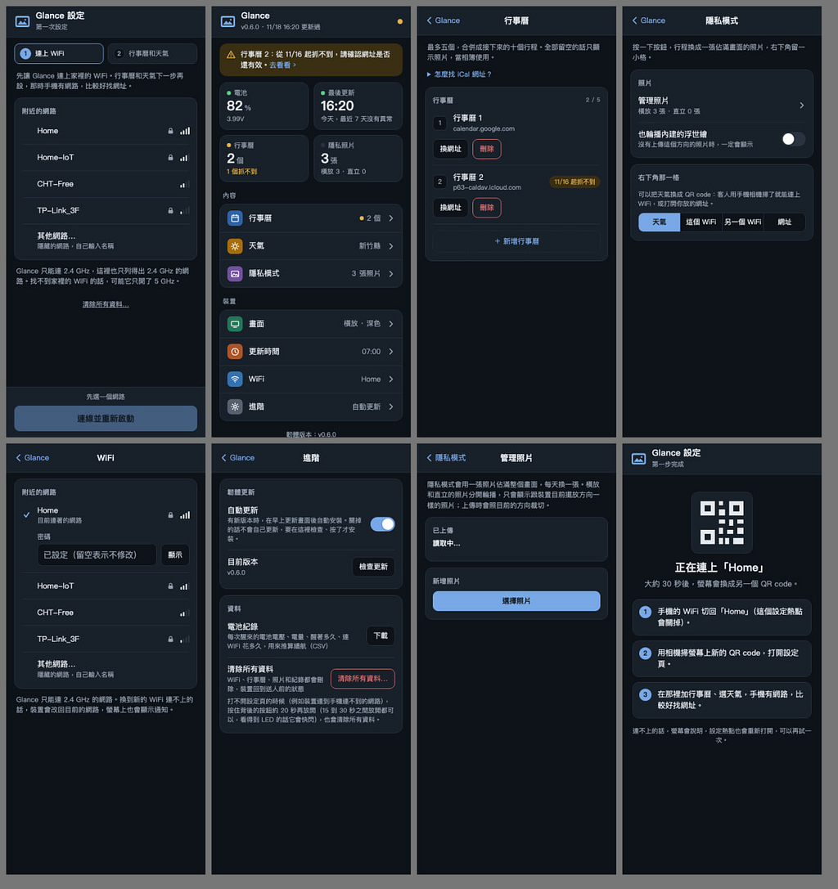
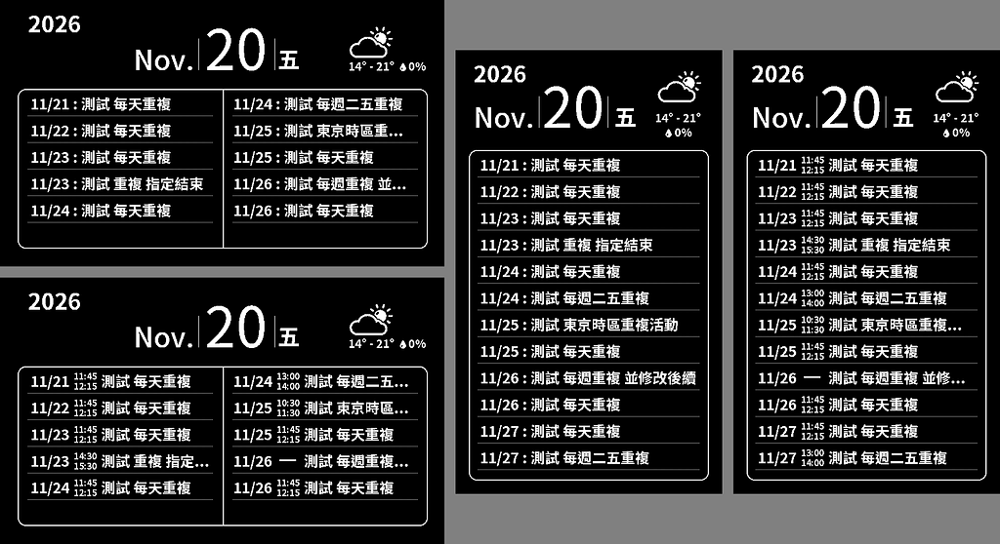
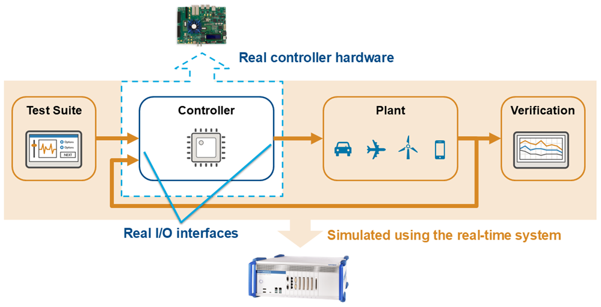

This article is **migrated** from [Medium](https://medium.com/@k2345777/%E9%9B%BB%E5%AD%90%E7%B4%99%E6%9C%88%E6%9B%86v2-%E6%88%91%E4%B8%8D%E5%AF%AB%E4%BA%86-%E7%94%9A%E8%87%B3%E4%B9%9F%E4%B8%8D%E8%AE%80code%E4%BA%86-84784f1fc219) and **translated** by Gemini 4 Neon High.

---

This one was written by me too.

I guess a slightly clickbaity title really is necessary, huh? Still, it's completely true. For E-Paper Calendar V2, up to this point I haven't written a single line of code — and I haven't even looked at what's inside the codebase.

### If I Didn't Write the Code, Is It Still My Project?

Maybe that's not even news anymore — who writes code by hand these days anyway? Still, if I didn't write any of the code, and I don't even read it anymore, does this project still belong to me?

To me, the real difference comes down to one question: **did you design the product?** In other words, if someone asks me why I put an e-paper display inside a picture frame, why it isn't plugged into a charging cable, or whether their private data is safe — can I answer those questions thoughtfully, and was the device built to execute on those design decisions? I think *that* is what makes this device truly mine.

### Letting Go of the Code

On top of that, having AI tools meant I could not only build these features quickly, but also refine them step by step until they matched the exact blueprint in my head. All of these interactive configuration screens are things I would never have spent the energy building in V1. It's not that I didn't want them — it's that just getting V1's basic functionality working already drained everything I had. I spent several times the effort just to barely pull off what AI can now do in a single prompt.

Once AI reached this level of efficiency, writing and reading code manually stopped feeling like a good use of time. At least for developing a device like this where all the technical information is well-documented, writing the code myself simply stopped making sense.

That's also why this project dragged on for a full year. For the first eight months, I was mostly figuring things out on my own, and probably accomplished less than 5% of where the project is today. Later, as more AI tools emerged, I tried GPT, then switched to Gemini — rebuilding the foundation from scratch each time I switched tools. Both times, I still tried to collaborate closely and write code together with the AI, and neither turned out great. It wasn't until I switched to Claude that, without really overthinking it, I naturally stopped looking at the code altogether. I just knew Claude would take care of it.

### Removing the Biggest Bottleneck: Myself (via HIL)

Of course, things didn't always go smoothly — and this brings up a major challenge unique to embedded development. In a pure software environment, you give AI a goal, and it can easily write the code and write tests to verify its own correctness. With hardware, however, you have to flash the firmware onto a physical board, and then a human has to physically observe how the circuit behaves and look at the screen to see if the rendered output matches what you wanted. Predictably, wherever a human has to step in, we humans become AI's biggest bottleneck (sigh).

So in my latest workflow, the very first problem I tackled was that exact bottleneck — essentially, removing *myself* from the loop! I had AI quickly build a software simulator to stand in for the physical display. After AI flashes the firmware onto the real board, instead of pushing the rendered image to a physical e-paper panel, the board outputs it to the simulator as an image file. That way, AI can inspect the rendered image on its own to verify whether the firmware output looks right, and iterate on the UI without any human intervention.

This isn't really a new technique — it's just the classic **HIL (Hardware-in-the-Loop)** workflow, something I happened to pick up back when I was working on drones.

Flight-testing unreliable software on a real drone is way too expensive, so early validation happens inside a flight simulator — except the core computation still runs on the actual hardware that will eventually fly inside the aircraft. That lets you check whether the real hardware and firmware can handle edge cases properly, without risking an expensive drone.

### Closing Thoughts

Anyway, that's my takeaway from this whole journey. To this day, I still haven't looked at what the code I [open-sourced on GitHub](https://github.com/bolintw/Glance) actually looks like, nor do I know which frameworks or patterns it used under the hood. Yet stepping back let me focus completely on designing the product properly and pulling off things that would have been impossible in V1. And honestly, I've been enjoying it quite a bit — maybe I never loved writing code as much as I thought I did.
